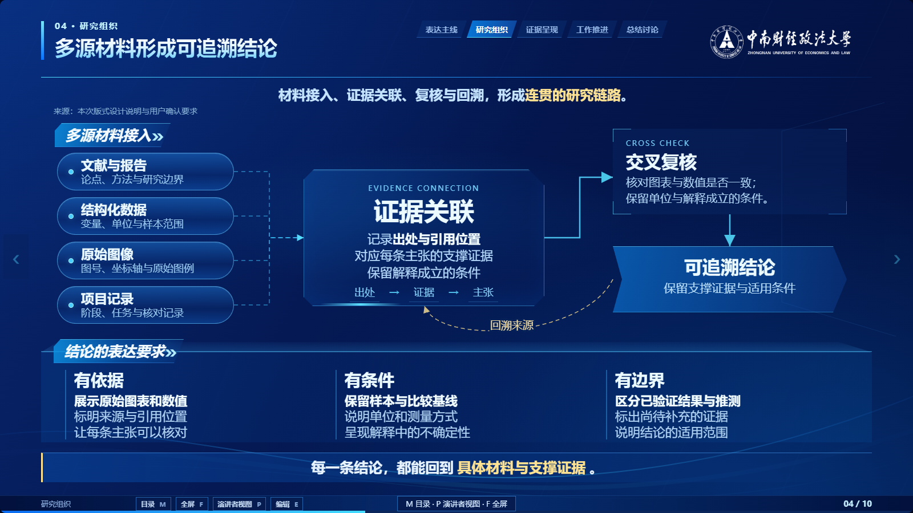
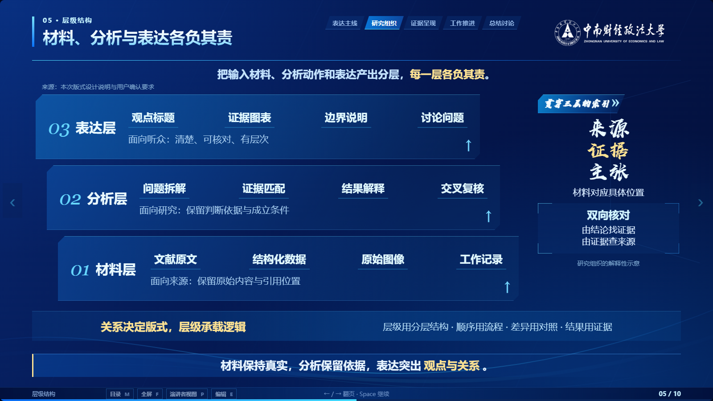
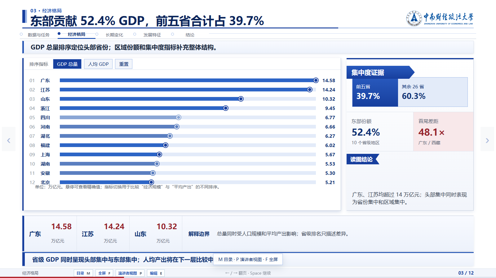
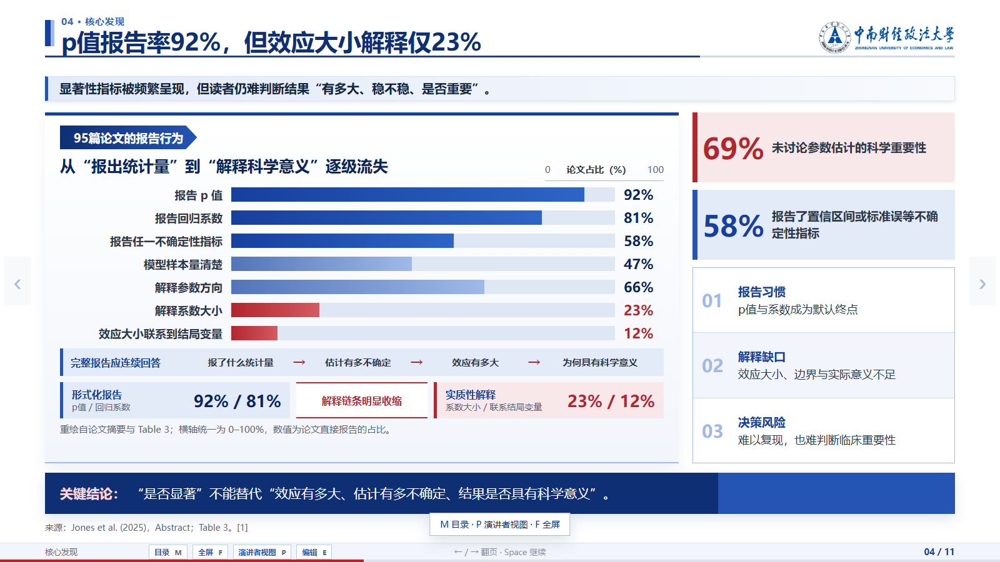
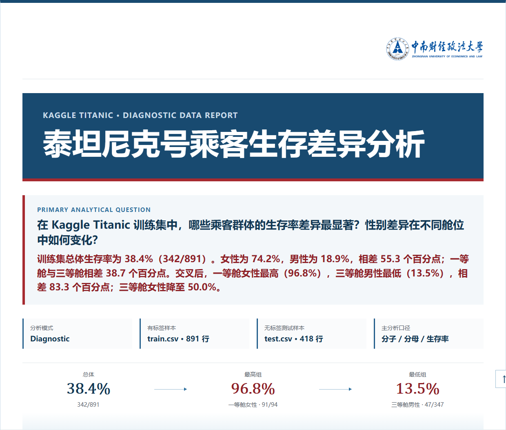
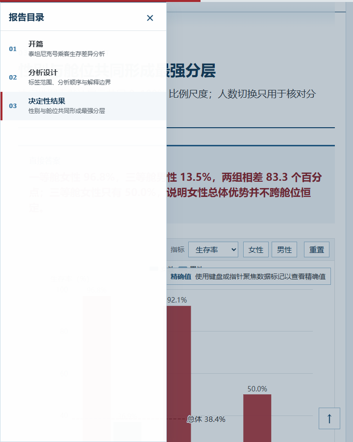
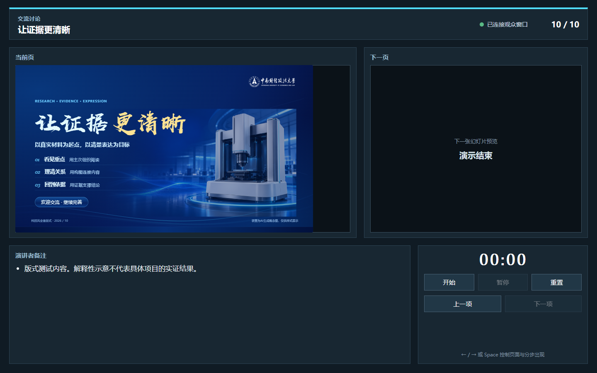

# Research HTML Presentation

**Turn papers, documents, and datasets into evidence-led HTML research decks and interactive reports, with traceable sources and in-browser editing.**

[简体中文](README.md)

> MIT licensed · No logo by default · Optional branding and licensed typography

Research HTML Presentation is a coding-agent skill for group meetings, literature reviews, project updates, course reports, and dataset-led analysis. It guides a local agent through source inspection, evidence organization, a three-unit prototype, implementation, and rendered review. Codex on Windows is the primary locally tested environment.

## See the results

These are screenshots of existing work, with the original typography and optional institutional branding retained. New projects still start without a logo.

### Technology deck


| Evidence relationships | Layered research structure |
| --- | --- |
|  |  |

[All 10 technology pages](docs/index.html#technology) · [GitHub image gallery](docs/SHOWCASE.md#technology)

### Academic deck



[All 12 academic pages](docs/index.html#academic)

### Literature review



[All 11 literature-review pages](docs/index.html#literature)

### Vertical report

| Opening and direct answer | Chapter navigation |
| --- | --- |
|  |  |

[Report screenshots](docs/index.html#report)

### Presenter View



**[Full visual gallery](docs/index.html)** · **[Images viewable directly on GitHub](docs/SHOWCASE.md)**

The gallery shows actual screenshots; it is not an interactive presentation runtime. GitHub shows HTML as source: download and open `docs/index.html`, or use a static host after publication. Fonts, marks, source figures and data retain their respective rights. See [third-party notices](THIRD_PARTY_NOTICES.md).

## Get started

In Codex with skill-installer available:

```text
$skill-installer
Install skills/research-html-presentation from
https://github.com/Estelaqwq/research-html-presentation
```

Then select or mention `$research-html-presentation`. If the client does not discover the installation, refresh as directed by the client.

Alternatively, clone the repository:

```bash
git clone https://github.com/Estelaqwq/research-html-presentation.git
cd research-html-presentation
```

Ask an agent with file and shell access to read `skills/research-html-presentation/SKILL.md`. Keep its supporting files available; SKILL.md alone is not the complete package. Other agents require their own tool and compatibility checks. A source repository, plugin packaging, and public directory approval are separate milestones.

## Example requests

### Literature presentation

```text
Use $research-html-presentation.
Turn the attached paper into a 10-slide, 16:9 HTML group-meeting presentation.
Use academic-light, keep the main source figures and quantitative findings,
and explain the limitations for an audience familiar with the basic method.
Show the cover, a method page, and a decisive result before completing the deck.
```

### Work report

```text
Use $research-html-presentation.
Create a vertical HTML work report from these documents and meeting notes.
Use academic-light. Explain completed work, supporting material,
open questions, and next actions without forcing a statistical-model workflow.
```

### Dataset report

```text
Use $research-html-presentation.
Analyze the attached CSV and produce a vertical HTML research report.
Use academic-light. Compare how the groups change over time.
Check missingness, units, coverage, and comparison baselines;
record transformations and build the narrative around verified results.
```

New projects contain no institutional logo by default. An explicit request such as “add the ZUEL logo” activates the optional treatment; source affiliations do not. Revisions preserve the existing project's branding unless changed explicitly. Public distribution of identity assets follows their separate asset policy.

## Two output forms

| | HTML slide deck | Vertical HTML report |
| --- | --- | --- |
| Intended use | Live projection and page-by-page explanation | Scrolling explanation and independent reading |
| Layout | Fixed 1600×900 stage, scaled as a whole | Content-driven document flow with narrow-screen adaptation |
| Navigation | Keyboard paging, chapters, progress | Section links, scrollspy, reading progress |
| Speaker support | Separate Presenter View | Optional speaking and interaction tools |
| Static output | Validated 16:9 PDF | Deterministic report print and browser PDF |

The skill resolves the form before analyzing and outlining a new task. A confirmed choice is retained.

## Core capabilities

- **Research-focused storytelling.** Connect questions, methods, results, interpretation, and boundaries. Papers, work materials, and datasets follow appropriate content routes.
- **Traceable evidence.** Keep important claims, sources, figures, and derived results connected. Reconstruct figures only from verified structured data; preserve complex source images when reconstruction would lose meaning.
- **Interactive and scientific charts.** Use questions and baselines to choose charts, including distributions, paired observations, trends with intervals, coefficients, diagnostics, and mixed panels. Missing observations and zero remain distinct.
- **Browser editing.** New projects include an Edit / E entry for ordinary text and content images, with save, undo, redo, and reset. Authoritative data, chart internals, controls, and official identity regions remain protected.
- **Prototype and rendered checks.** Review three real-content units before expanding the artifact, then check the full output in its intended runtime, print state, and layout.
- **Dataset-report exploration.** New dataset-driven scroll reports default to populated aggregate-evidence questions, data-health checks, and an editable analysis-flow diagram. Ordinary work reports do not inherit empty analysis controls.

Editing uses a project-local save service when available and browser-local storage as a fallback. Moving edits to another device requires exporting the supported changes or a modified offline HTML; local browser storage does not synchronize automatically.

Aggregate exploration uses bounded, verified calculations by default. Natural-language model access is an explicit optional server configuration and cannot run as a server feature inside a static offline file.

## Visual styles

`academic-light` uses white surfaces, cobalt structure, deep-blue titles, and restrained red emphasis. `tech-engineering-dark` uses royal-blue depth, white/ice-blue titles, cyan structure, and limited pale-gold emphasis. Both preserve the shared research, evidence, editing, and runtime rules. Special display fonts depend on the actual asset license and configuration.

## Requirements

Use a local coding agent with material-reading, file-writing, and shell capabilities; Node.js and a package manager for React/Vite/TypeScript builds; and Chromium/Playwright for automated rendering, runtime checks, and deck PDF. Python and analysis libraries are task-dependent. Local combination regression used Node.js 24; other environments need their own verification.

Structured charts use a local ECharts adapter. Scientific static exports may use NumPy and Matplotlib. Installing project dependencies and viewing an already packaged output have different requirements.

## Delivery and scope

The agent delivers the project path and available preview entry. Built artifacts can be hosted statically when their paths and assets support it. There is no automatic public URL for every report. Scroll reports have a dedicated offline export path; server-backed model options must first follow the offline rules.

This project targets HTML output and does not claim native editable PPTX export. Evidence checks do not certify scientific conclusions. Local-first editing does not determine the data policies of the coding agent, optional model services, or hosting provider. Equivalent end-to-end coverage for other operating systems and clients is not yet established.

## Repository and contributions

The `skills/research-html-presentation/` directory is the single maintained core. Repository documentation provides the distribution and usage entry points. Branded and unbranded generation share one implementation.

For issues, provide the environment, selected form, reproduction steps, errors, and a sanitized minimal input. Changes to charts, editing, interaction, or export should include relevant runtime results and screenshots.

## License and assets

Original code and workflow rules use the [MIT License](LICENSE), permitting commercial use, modification and redistribution while retaining the copyright and license notices. Third-party fonts, institutional marks, figures and datasets retain their respective rights. Hanyi font files are not included in the public installation package; users obtain any optional font from the official source under the applicable terms. Existing screenshots retain their original appearance. See [THIRD_PARTY_NOTICES.md](THIRD_PARTY_NOTICES.md).

## Optional title font

No proprietary Hanyi font is bundled. Technology decks use local KaiTi/serif fallback. With appropriate use and embedding permission, pass `--display-font <full WOFF path>` or set `RESEARCH_HTML_PRESENTATION_FONT`. Both paths use the same skill source.

## Local maintenance

Maintain the single source under `skills/research-html-presentation/`. Run `node tools/sync-local-skill.mjs` after updating the repository to copy it into the current user's Codex skill directory, preserving private local font files.
