# Research HTML Presentation

**把论文、文档和数据，整理成证据可追溯、可交互、可编辑的科研 HTML 演示文稿与竖版报告。**

[English](README.en.md)

> MIT 许可 · 默认无校标 · 支持可选品牌与字体配置

Research HTML Presentation 是面向科研汇报的编码智能体 skill，主要在 Codex 本地环境中使用。提供论文、文档、研究笔记或结构化数据，说明听众和目标，即可沿着材料分析、证据整理、原型确认和页面检查的流程，制作适合现场讲解或自主阅读的 HTML 成果。

适用于组会、文献汇报、课题汇报、工作进展、课程报告和数据分析。

## 先看效果

**默认采用蓝白学术风格**，也支持深色科技风，以及适合连续阅读的竖版报告。下面使用此前已经完成的作品，保留原有校标和字体效果；新项目仍默认无校标。

### 01 · 默认蓝白风格：数据分析报告

`china-provincial-economy-analysis-v3` · 12 页完整成品。从数据口径、分析路径到图表结果与综合判断，展示高信息量内容如何组织成一套汇报。

**全页总览**

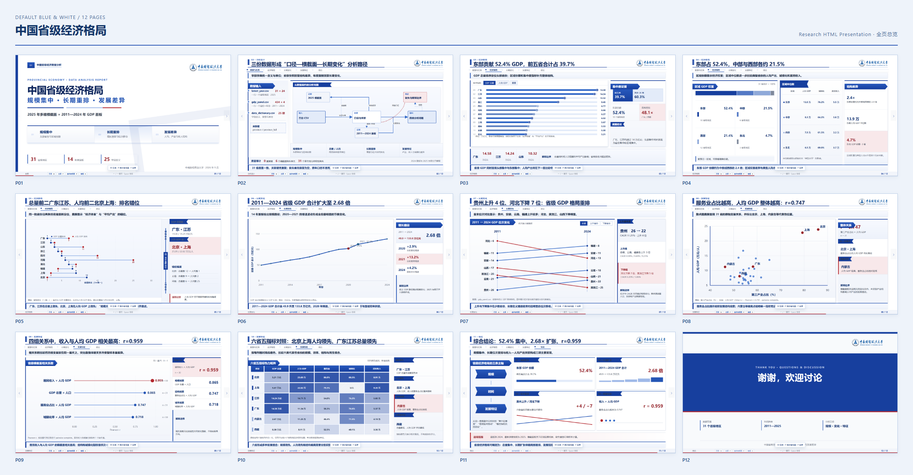

**P1 · 封面**

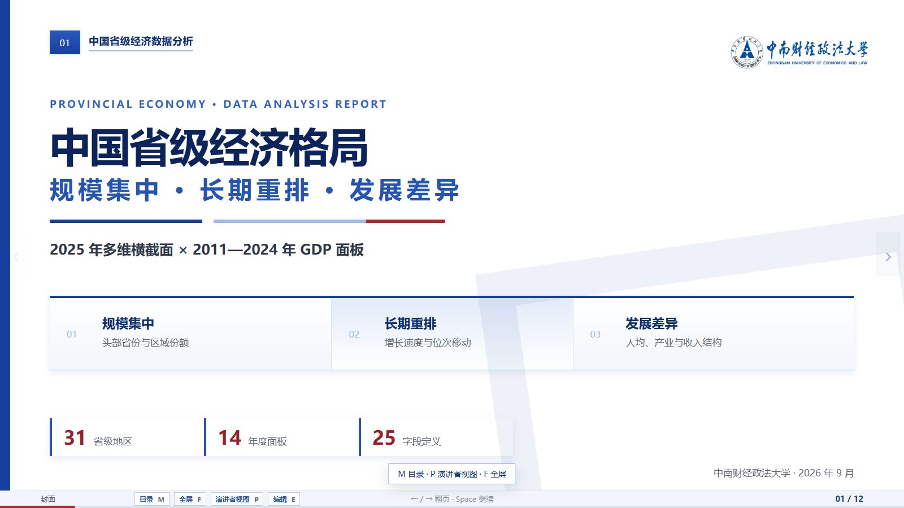

**P2 · 数据与分析路径**

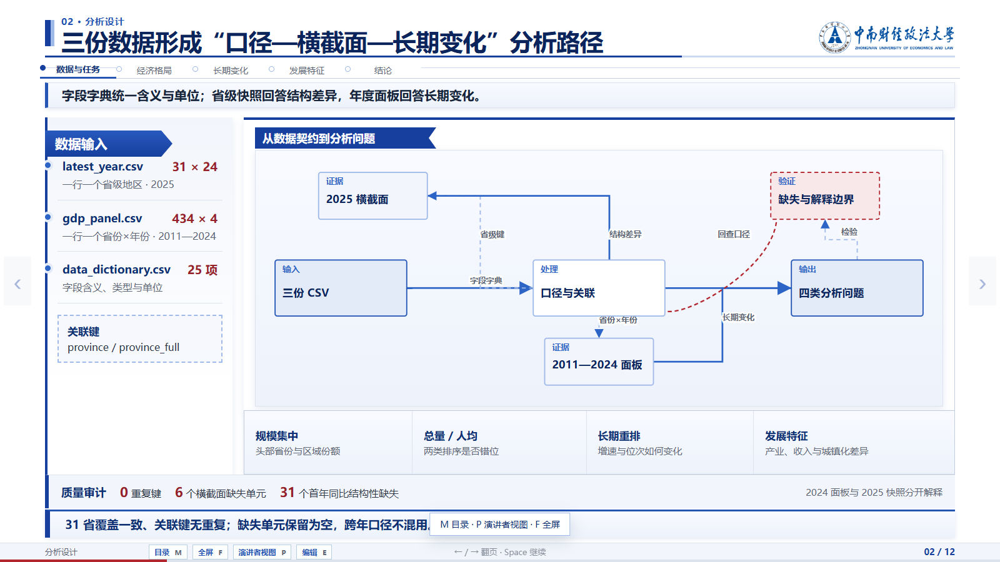

**P3 · 规模集中与排名**


**P10 · 多指标对照**

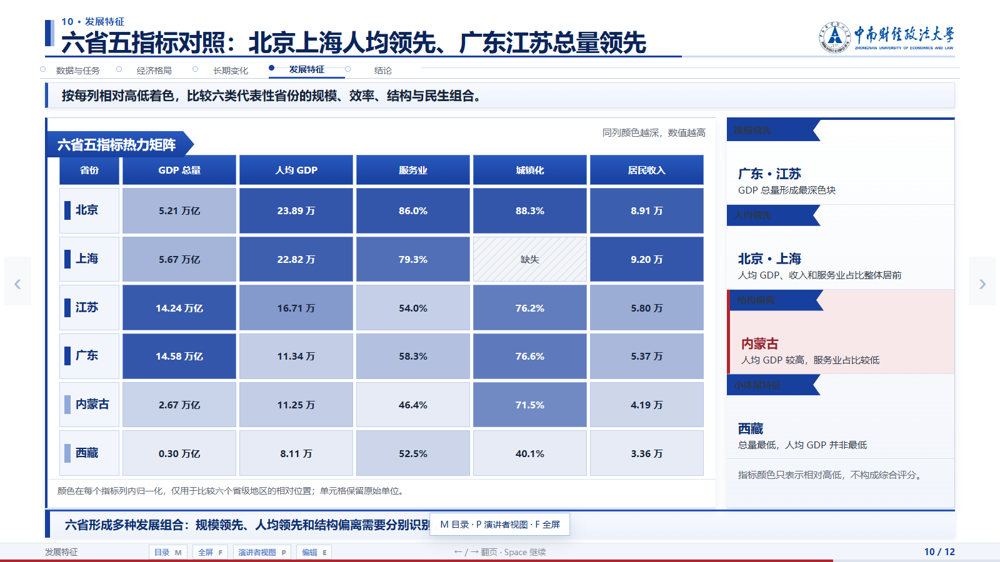

**[查看完整 12 页 PDF →](docs/previews/provincial-economy.pdf)** · [逐页图片](docs/SHOWCASE.md#academic)

### 02 · 蓝白文献汇报：随机生存森林与淋巴瘤预后

`nhl-rsf-literature-review` · 11 页完整成品。将论文原图、重绘比较图和解释边界放进同一条汇报叙事。

**P1 · 文献封面**

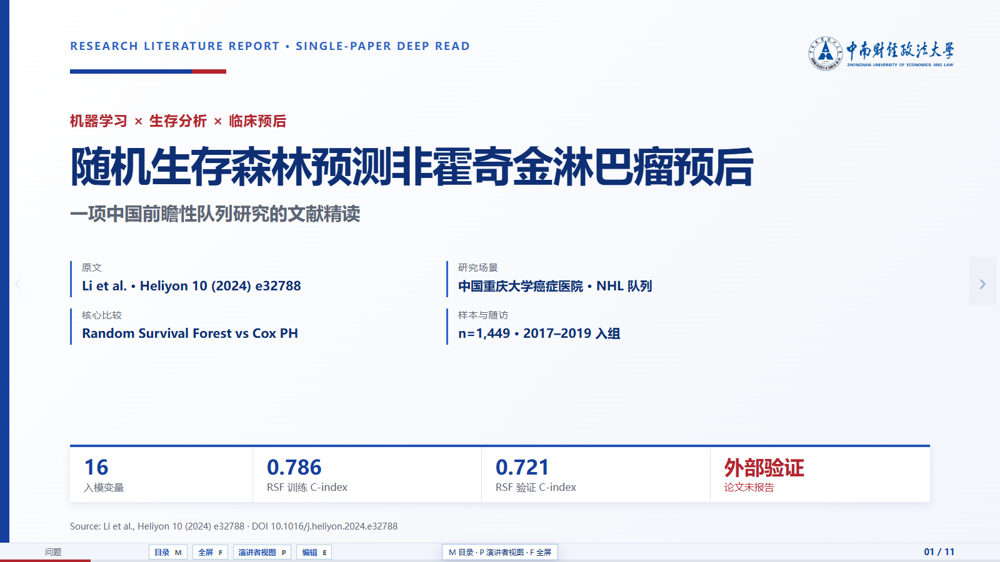

**P6 · 保留原始 ROC 图，展开不同预测时间窗**

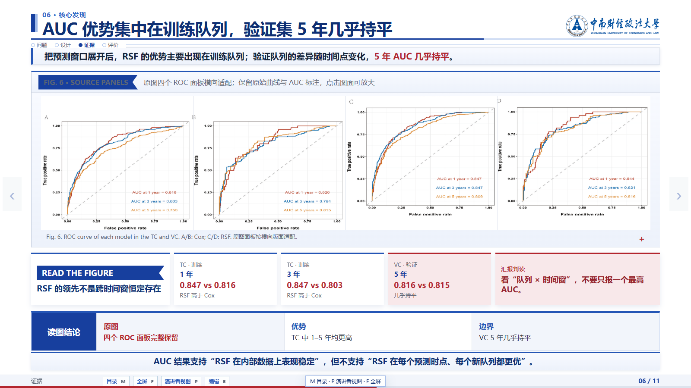

**P5 · 区分训练表现与验证表现**

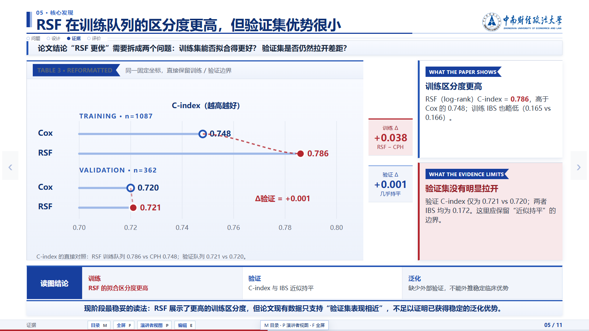

**[查看完整 11 页 PDF →](docs/previews/nhl-rsf-literature-review.pdf)** · [逐页图片](docs/SHOWCASE.md#literature)

### 03 · 深色科技风：技术路线与研究表达

深色底、蓝色层次与手书标题，适合技术路线、工程方法和计算研究。以下为既有的 10 页版式样稿。

**全页总览**

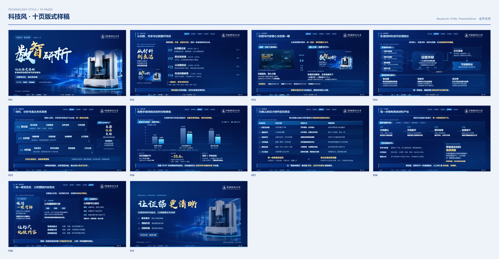

**P1 · 科技风封面**


**P4 · 多源材料与证据关联**


**P6 · 定量结果与图表表达**

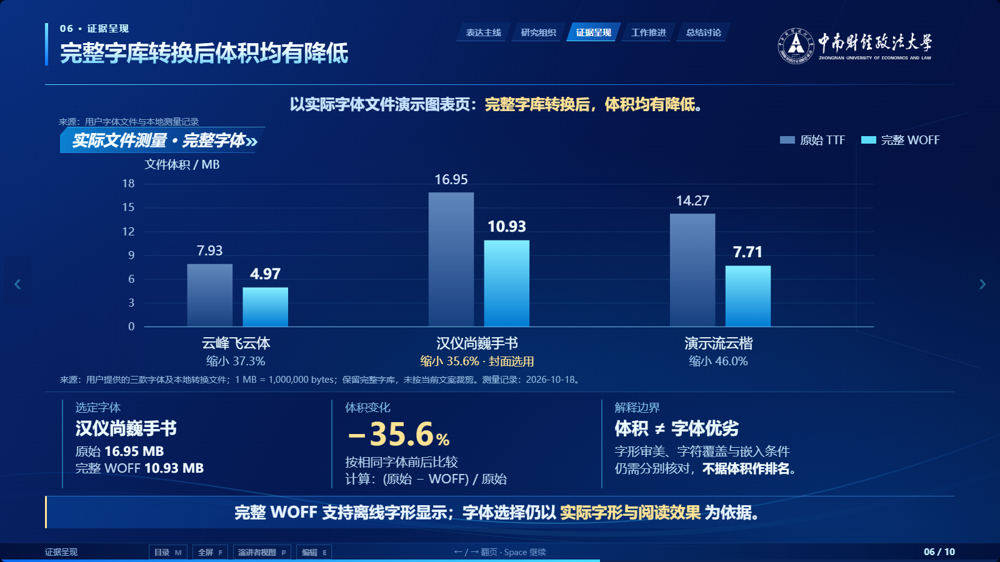

**[查看完整 10 页 PDF →](docs/previews/technology-deck.pdf)** · [逐页图片](docs/SHOWCASE.md#technology)

### 04 · 竖版报告：从开篇到交互探索

`titanic-survival-analysis/scroll-report` · 泰坦尼克号乘客生存预测。连续滚动的正文配合章节目录、图表交互和解释说明，适合自己阅读、核对和探索。

**报告开篇 · 研究问题、直接答案与关键指标**

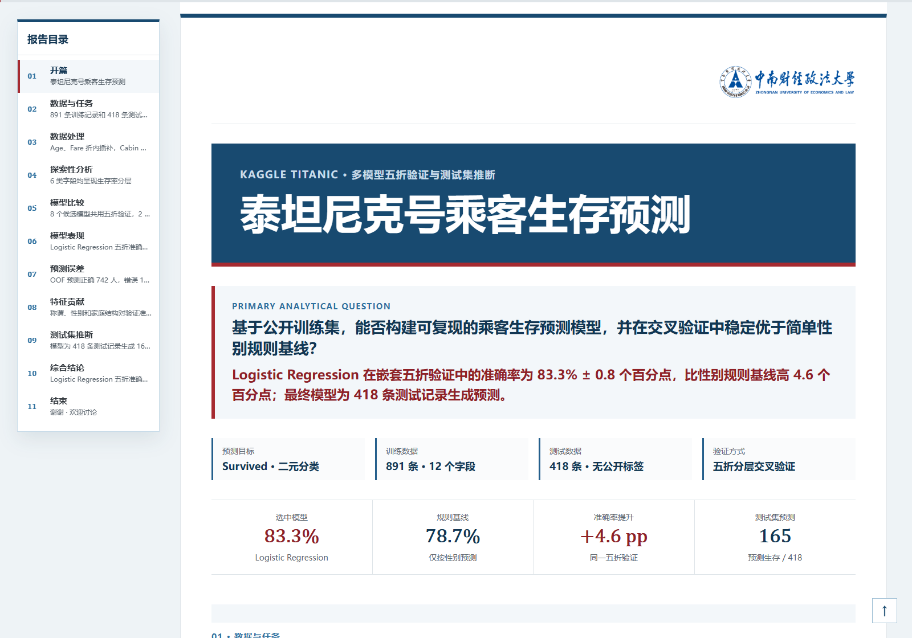

**预测误差 · 查看一个单元格的具体含义**

将指针停在“实际生存、预测未生存”的单元格，可查看漏判生存者 83 人的提示，同时对照召回率、精确率与错误结构。

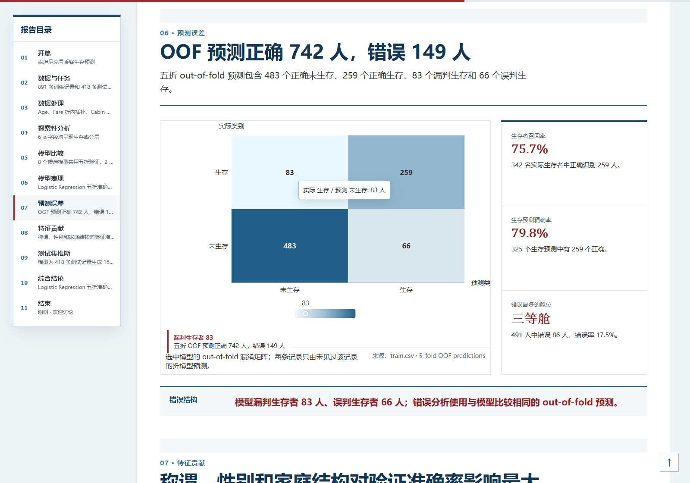

**报告目录 · 在较窄窗口展开全部 11 个章节**

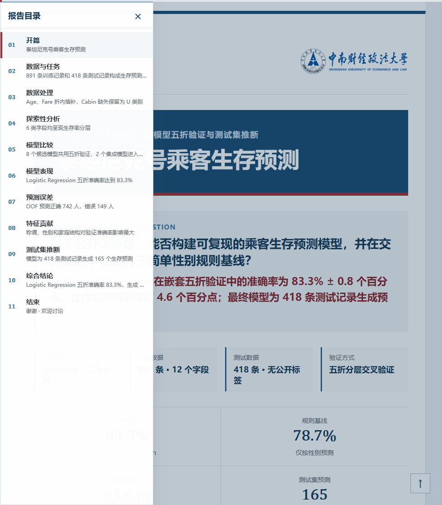

[查看竖版报告截图 →](docs/SHOWCASE.md#report)

### 05 · 数据分析报告：研究助手与分析流程

`world-bank-asia-research-report-prototype` · 六国碳排放变化与发展指标（2000—2024）。完整报告除正文与交互图表外，还提供两个探索入口。

**研究助手 · 追问数据，核对来源**

围绕本节选择追问，查看由已登记汇总数据计算的答案、来源与筛选口径；还可通过比较向导选择指标、国家和年份，把有用发现保存为个人笔记。下图展示“中国 2010—2020 年累计排放是多少？”的实际回答。

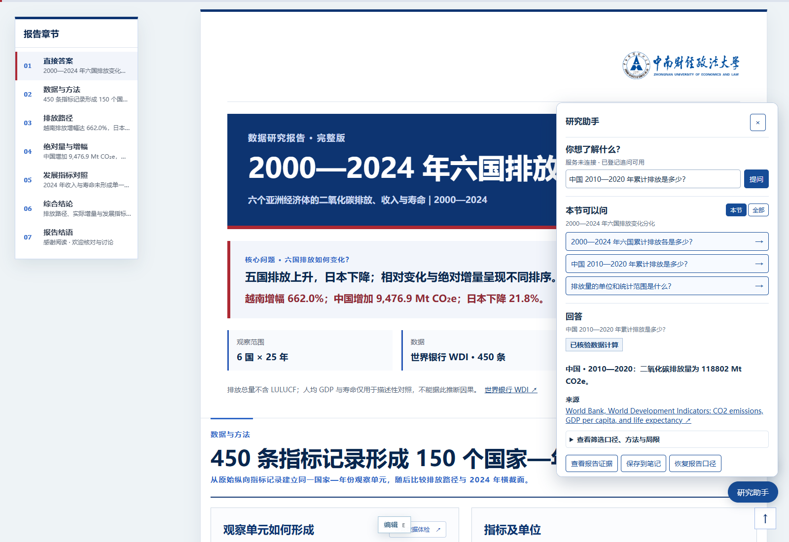

已登记追问可在模型服务未连接时使用；开放式自然语言提问需要另行配置模型服务。

**分析流程 · 看懂数据如何成为结论**

将原始数据、筛选处理、计算、分析发现与报告串成可点击的流程图。点击节点查看说明，也可编辑节点、位置与连接，保存修改或恢复初始版。

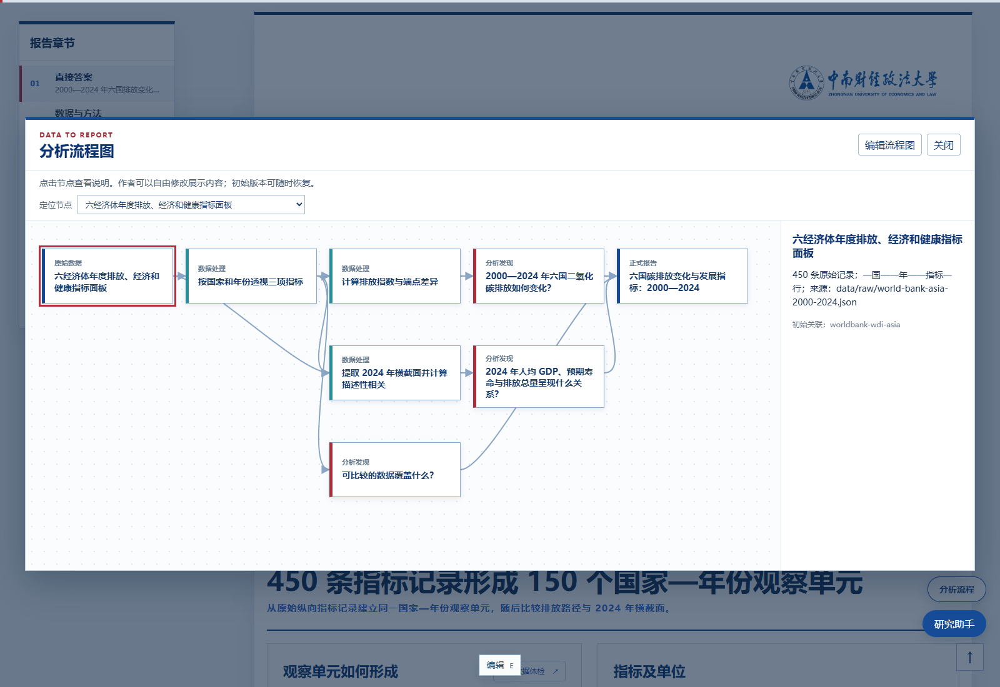

[查看数据报告功能截图 →](docs/SHOWCASE.md#analysis-tools)

<details>
<summary>演示辅助：查看演示者视图</summary>

当前页、下一页、讲稿与计时放在同一工作区，方便现场讲解。


</details>

**[在 GitHub 内继续浏览图文示例 →](docs/SHOWCASE.md)**

完整演示稿通过上方 PDF 链接预览，也可下载查看。PDF 和截图展示静态效果，图表交互需打开实际 HTML 成果。截图中的字体、标识、论文图表与数据权利归原权利人，详见[第三方素材说明](THIRD_PARTY_NOTICES.md)。

## 快速开始

### 安装到 Codex

在支持 skill-installer 的 Codex 中发送：

```text
$skill-installer
请从 https://github.com/Estelaqwq/research-html-presentation
安装 skills/research-html-presentation 目录中的 skill。
```

安装后选择或提及 `$research-html-presentation`。如客户端未识别新安装内容，重新打开会话或按客户端提示刷新。

### 从本地仓库直接使用

```bash
git clone https://github.com/Estelaqwq/research-html-presentation.git
cd research-html-presentation
```

让具有文件和终端访问能力的智能体读取仓库中 `skills/research-html-presentation/SKILL.md`，再提供待汇报材料。仅复制 SKILL.md 不能得到完整脚本、组件和规则文件。

本项目以 Codex 环境为主要验证目标。其他智能体可以读取相同工作流，但工具、安装入口与浏览器能力需要分别确认。插件包装与公开目录收录是不同环节；当前通过 GitHub 分发 skill，尚未上架插件目录。

## 这样提出需求

### 论文与文献汇报

```text
使用 $research-html-presentation。
把附件论文整理成 10 页、16:9 的组会 HTML 演示文稿，
采用 academic-light 风格，面向了解基础方法的同学，讲解约 12 分钟。
保留关键原图、定量结果和适用边界。
先展示封面、方法和决定性结果三页原型，确认后再完成。
```

### 文档与工作进展

```text
使用 $research-html-presentation。
根据这些 Word、PDF 和会议记录制作竖版 HTML 工作汇报，
采用 academic-light 风格，梳理已完成事项、依据、待解决问题和下一步。
保留材料中的真实信息，不把普通进度汇报强行改成统计建模任务。
```

### 数据分析与交互报告

```text
使用 $research-html-presentation。
分析附件 CSV，制作可上下滚动的 HTML 研究报告，
采用 academic-light 风格，重点回答各组如何变化、比较基准是什么。
先检查字段、缺失值、统计口径和数据覆盖范围，
记录清洗与计算过程，再用真实结果组织图表和解释。
```

### 中南财校标

```text
使用 $research-html-presentation。
制作 16:9 HTML 文献汇报，采用 tech-engineering-dark 风格，
加上中南财校标。
```

新项目默认不添加任何机构校标。只有明确要求时才启用 ZUEL 选项；论文作者单位、数据发布机构或一句学校名称不会自动触发。修改已有项目时沿用其品牌选择，除非明确要求改变。标识的公共分发处理以素材清单为准。

## 选择适合的输出形式

| | 16:9 HTML 演示文稿 | 竖版 HTML 报告 |
| --- | --- | --- |
| 使用方式 | 投屏、逐页讲解 | 连续阅读、上下滚动 |
| 页面组织 | 固定 1600×900 逻辑画布，整体等比缩放 | 内容驱动的正常文档流，适配窄屏 |
| 导航 | 键盘翻页、章节目录、进度 | 章节跳转、滚动定位、阅读进度 |
| 讲解辅助 | 独立演示者视图、讲稿与计时 | 按报告配置启用讲述提示与交互入口 |
| 静态交付 | 经检查的 16:9 PDF | 确定顺序的报告打印或浏览器另存为 PDF |

两种形式共用内容、证据与引用规则；每项新任务会先确认形式。如果已经明确指定，流程会继续使用该选择。

## 主要能力

### 围绕研究问题组织内容

从材料中辨认必须展示的证据、可压缩说明和备用信息，把问题、方法、结果与解释连接起来。论文、工作文档和数据分析各自采用合适的叙事流程；材料不充分时，明确保留尚未得到支持的部分。

### 保留来源与图表含义

记录重要结论、数据变换、图表和来源之间的联系。复杂科学图片优先保持原始像素与安全裁切；只有存在可核验结构化数据时才重建图表。轴、单位、样本量、不确定性和比较基准需要在表达中保留。

### 按分析问题选择图形

支持常用交互图表，以及分布、配对观测、趋势与区间、系数区间、回归诊断和组合图等科研图形。工具提示、分组切换和局部探索服务于具体问题；缺失值不会被随意填成零，静态打印采用预先声明的状态。

### 在浏览器继续修改

新项目默认带有“编辑 E”入口，可修改普通文字和内容图片，并支持撤销、重做、重置及保存。官方品牌、原始数据、图表内部和权威计算记录受到保护。修改后继续检查布局、来源与正式交付条件。

本地保存服务可用时写入项目；静态或离线环境使用浏览器本地存储作为后备。跨设备转移需要导出修改记录或项目支持的修改后 HTML，不能依靠浏览器本地保存自动同步。

### 先看原型，再完成全稿

新任务先制作三个真实内容的代表页面或段落，检查阅读、证据大小和交互后交给使用者确认。完整成果继续接受构建、结构、来源、浏览器行为与实际渲染检查。

### 为数据报告增加探索入口

新建的数据集驱动竖版报告默认配置聚合证据问答、数据体检和可编辑分析流程图，内容须由真实记录填充。普通文档或工作报告不会因此出现空的分析入口。

聚合问答默认使用受限、可验证的计算；自然语言模型服务是显式配置的可选项，不能在静态离线文件中提供服务器模型调用。

## 两种科研视觉风格

| 风格 | 视觉特点 | 常见使用场景 |
| --- | --- | --- |
| `academic-light` | 白底、钴蓝结构、深蓝标题、少量红色强调 | 文献、学术和高信息量工作汇报 |
| `tech-engineering-dark` | 宝蓝层次、白蓝标题、青蓝结构与少量浅金强调 | 技术路线、工程方法和计算研究 |

两种风格遵守相同的证据、运行和编辑规则。特殊标题字体需按实际授权配置；不会因为采用某种配色就自动添加校标。

## 需要什么运行环境

- 能读取材料、写入项目并执行命令的编码智能体。
- Node.js 和项目包管理器，用于 React / Vite / TypeScript 构建。本地组合回归使用 Node.js 24；其他版本需实际验证。
- Chromium 系浏览器；Playwright 用于自动渲染、运行检查和演示文稿 PDF。
- Python 3 和任务需要的分析/材料读取库。CSV 的基本分析、表格文件读取、统计建模与科学图形导出所需依赖不同。
- 安装生成项目的依赖时需要相应包源；读者浏览已打包成果与智能体生成项目是两个不同环节。

结构化图表使用项目本地 ECharts 适配层。静态科研图形导出按需使用 NumPy、Matplotlib；输入文件抽取和统计方法由任务与本地工具决定。

## 生成后如何使用

让智能体交付项目路径和本地预览入口。在演示文稿中，可使用目录、全屏、演示者视图和键盘导航；需要修改时使用“编辑 E”。竖版报告支持章节跳转与正常滚动阅读。

源项目可继续由智能体维护。已构建成果可以按实际素材和路径配置进行静态托管；本项目不会自动为所有报告创建公共网址。竖版报告提供独立离线导出路径，启用服务器模型服务的配置需先按离线规则处理。

## 使用边界

- 输出以 HTML 为主，当前不提供原生可编辑 PPTX 的生成保证。
- 来源、引用与统计检查能发现具体问题，正式学术结论仍需结合原始材料与方法审阅。
- 模型分析只在任务和数据适合时使用；图形组件不替代模型拟合或推断。
- 本地优先描述的是分析与编辑设计；所用智能体、模型服务和公开托管的资料传输范围需分别确认。
- 当前主要验证环境为 Windows / Codex；其他系统与客户端尚未完成同等范围的端到端验证。

## 仓库与贡献

本仓库中，`skills/research-html-presentation/` 保存唯一核心源码，包含 SKILL.md、规则、脚本、组件和结构约束。根目录中英文 README 提供分发和使用入口；有校标与无校标共用这套源码。

反馈问题时，说明使用环境、输出形式、复现步骤、报错和经过脱敏的最小材料。贡献涉及图表、交互、编辑或导出时，应同时给出对应的运行检查结果及渲染截图。

## 许可与素材

原创代码及规则采用 [MIT License](LICENSE)，允许商业使用、修改和再分发，需保留版权及许可声明。第三方字体、机构标识、论文图表和数据不因出现在示例中而改为 MIT 授权。汉仪字体文件不随公共安装包提供；如需启用，由使用者从官方渠道获取并遵守适用授权。示例截图保留原作品的校标和字体外观，详见 [THIRD_PARTY_NOTICES.md](THIRD_PARTY_NOTICES.md)。

## 可选标题字体

公共安装包不附带汉仪字体。科技风默认使用本机楷体或衬线字体回退。取得适当使用及嵌入授权后，可在调用生成器时添加 `--display-font <完整 WOFF 路径>`，或设置 `RESEARCH_HTML_PRESENTATION_FONT`。无需维护另一套 skill，既有截图与个人作品保持原样。

## 本地维护

唯一维护源码在 `skills/research-html-presentation/`。更新仓库后，可运行 `node tools/sync-local-skill.mjs` 将它复制到当前用户的 Codex skill 目录；本机私有字体文件会保留。发布和维护均以仓库源码为准。
