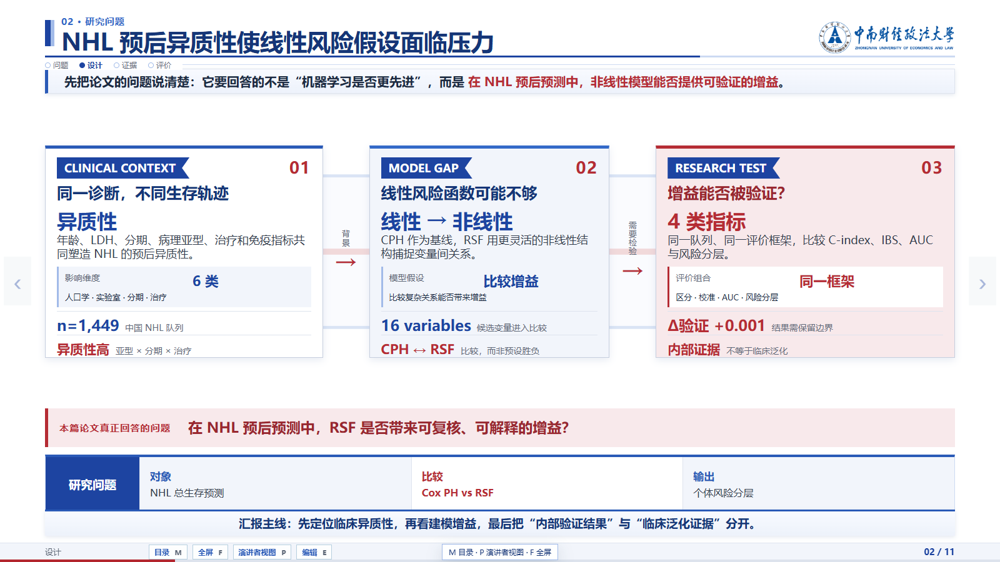
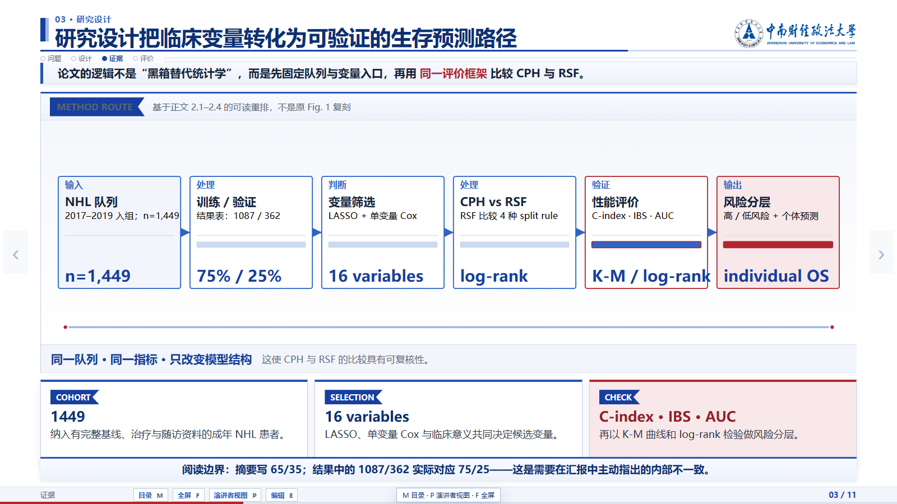
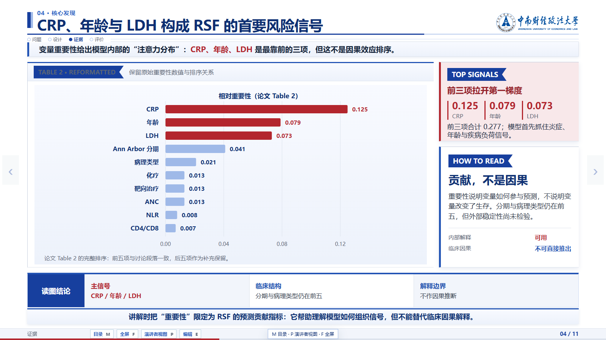
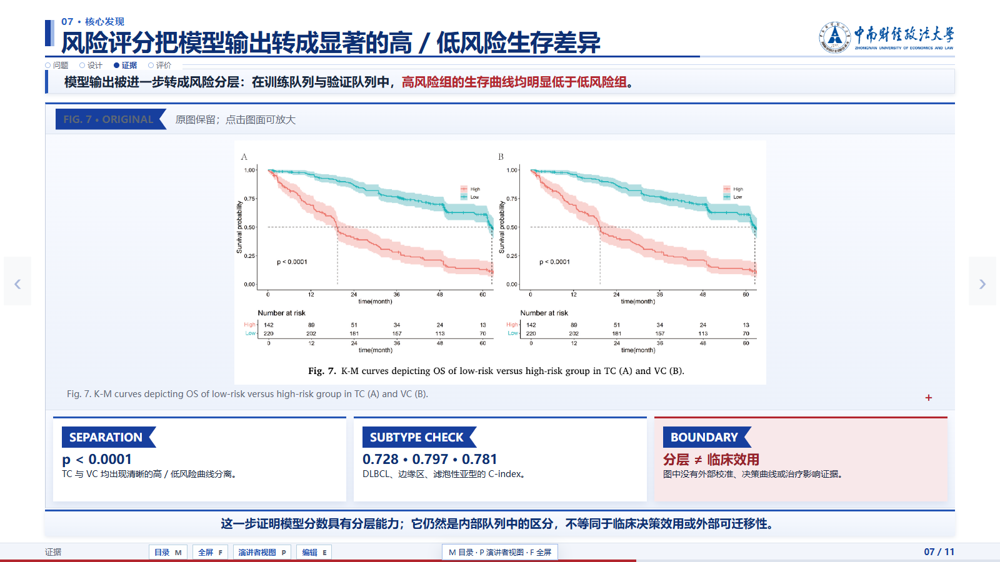
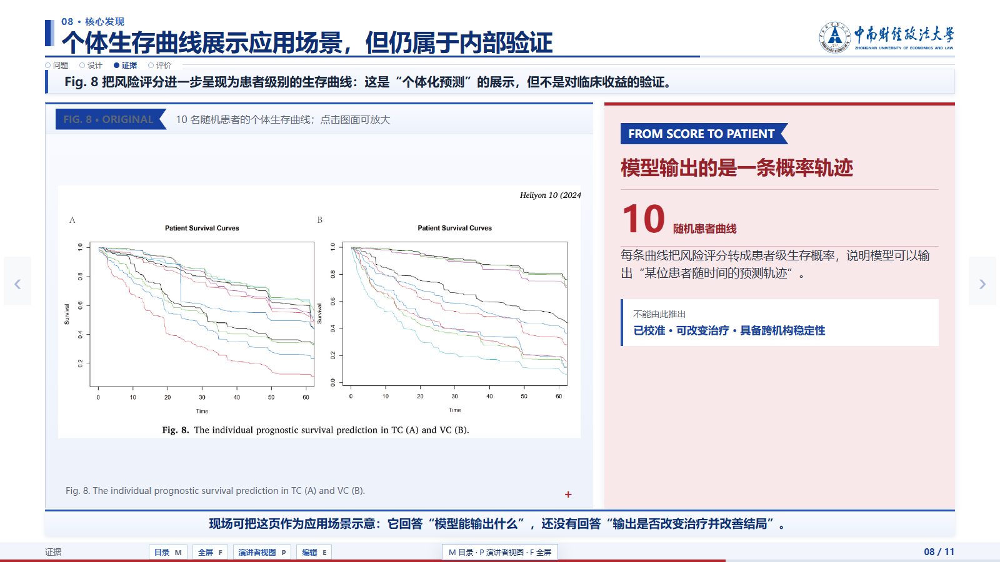
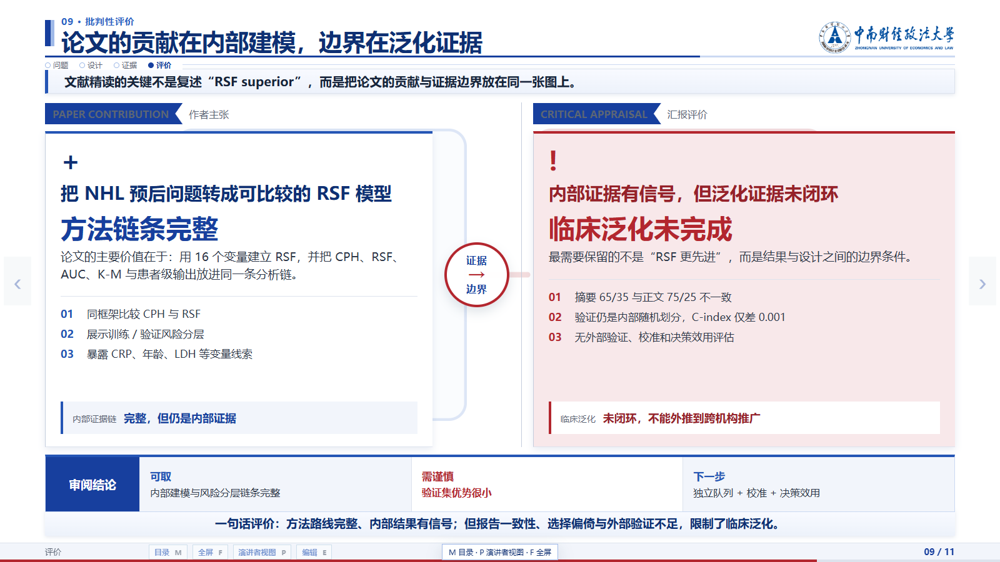
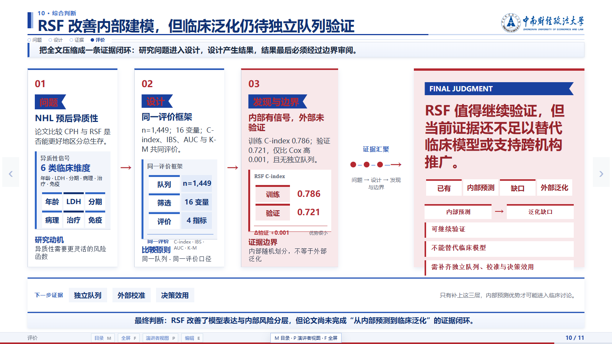
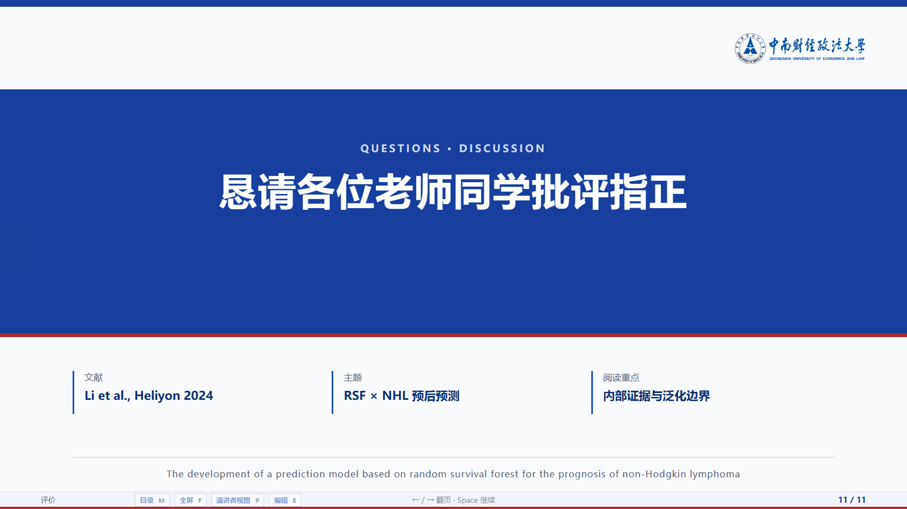

# 成品图库 / Existing work gallery

以下来自既有成品，保留原校标和字体效果。完整演示稿可直接打开 PDF 预览；每张图片均可点击查看原尺寸。

新项目默认无校标。第三方素材不自动适用 MIT，详见[素材说明](../THIRD_PARTY_NOTICES.md)。

## 默认蓝白 · 中国省级经济格局

白底钴蓝的高信息量页面。展示正式封面、数据设计、排名、长期变化、发展差异与结论。

**[查看完整 12 页 PDF →](previews/provincial-economy.pdf)**

既有数据分析成品截图；保留原页面标注的统计口径、来源和解释边界。

展开 12 张截图

### P1 · 中国省级经济格局规模集中 · 长期重排 · 发展差异

### P2 · 三份数据形成“口径—横截面—长期变化”分析路径

### P3 · 东部贡献 52.4% GDP，前五省合计占 39.7%

### P4 · 东部占 52.4%，中部与西部各约 21.5%

### P5 · 总量前二广东江苏、人均前二北京上海：排名错位

### P6 · 2011—2024 省级 GDP 合计扩大至 2.68 倍

### P7 · 贵州上升 4 位、河北下降 7 位：省级 GDP 格局重排

### P8 · 服务业占比越高，人均 GDP 整体越高：r=0.747

### P9 · 四组关系中，收入与人均 GDP 相关最高：r=0.959

### P10 · 六省五指标对照：北京上海人均领先、广东江苏总量领先

### P11 · 综合结论：52.4% 集中、2.68× 扩张、r=0.959

### P12 · 谢谢，欢迎讨论

## 蓝白文献汇报 · 随机生存森林与淋巴瘤预后

以论文原图、模型对照与解释边界组织文献汇报。重点展示 P1、P6、P5。

**[查看完整 11 页 PDF →](previews/nhl-rsf-literature-review.pdf)**

既有 NHL / RSF 文献汇报；论文图表、数值与引文保留原页面出处，不随 MIT 重新授权。

展开 11 张截图

### P1 · 随机生存森林预测非霍奇金淋巴瘤预后

### P2 · NHL 预后异质性使线性风险假设面临压力

### P3 · 研究设计把临床变量转化为可验证的生存预测路径

### P4 · CRP、年龄与 LDH 构成 RSF 的首要风险信号

### P5 · RSF 在训练队列的区分度更高，但验证集优势很小

### P6 · AUC 优势集中在训练队列，验证集 5 年几乎持平

### P7 · 风险评分把模型输出转成显著的高 / 低风险生存差异

### P8 · 个体生存曲线展示应用场景，但仍属于内部验证

### P9 · 论文的贡献在内部建模，边界在泛化证据

### P10 · RSF 改善内部建模，但临床泛化仍待独立队列验证

### P11 · 恳请各位老师同学批评指正

## 深色科技风 · 十页版式样稿

宝蓝底色、手书标题与清晰的信息层级。保留此前确认的封面、方法、结构、图表、对照与总结。

**[查看完整 10 页 PDF →](previews/technology-deck.pdf)**

既有版式展示样稿；装置为 AI 生成概念图，页面说明与示意不代表实证研究。

展开 10 张截图

### P1 · 数智研析

### P2 · 从问题、关系与证据展开讲述

### P3 · 标题与内容重心决定第一眼

### P4 · 多源材料形成可追溯结论

### P5 · 材料、分析与表达各负其责

### P6 · 完整字库转换后体积均有降低

### P7 · 已确认的设计细节逐项落实

### P8 · 每一步都有具体材料产出

### P9 · 统一视觉语言，让构图随内容变化

### P10 · 让证据更清晰

## 竖版报告 · 泰坦尼克号生存预测

完整十一节报告的开篇、预测误差悬停状态和展开的章节目录。

既有 Kaggle Titanic 历史数据分析；误差图选取实际生存、预测未生存的 83 人单元格。截图仅提供汇总结果。

展开 3 张截图

### 报告开篇 · 研究问题、答案与指标

### 预测误差 · 悬停漏判生存者 83 人

### 报告目录 · 展开全部 11 个章节

## 数据分析报告 · 研究助手与分析流程

六国碳排放与发展指标完整报告中的实际操作：证据追问和可编辑分析流程。

世界银行 WDI 汇总数据。截图中的回答由已登记数据计算；模型服务未连接。流程图展示既有分析链。

展开 2 张截图

### 研究助手 · 已核验回答、来源与比较向导

### 分析流程 · 数据、处理、发现与正式报告

## 演示者视图

可下载仓库后打开 `docs/index.html` 使用带图片放大功能的本地图库。
